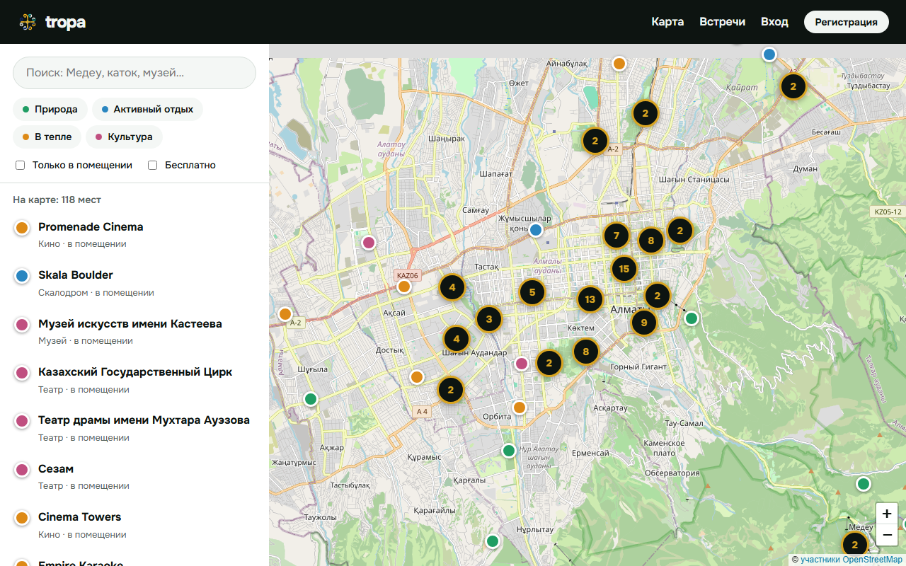
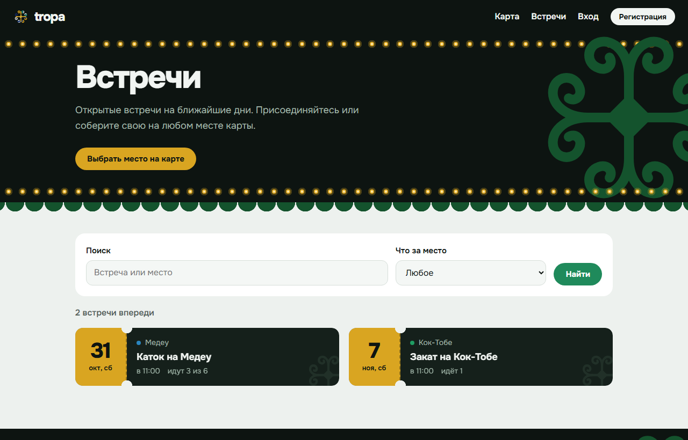
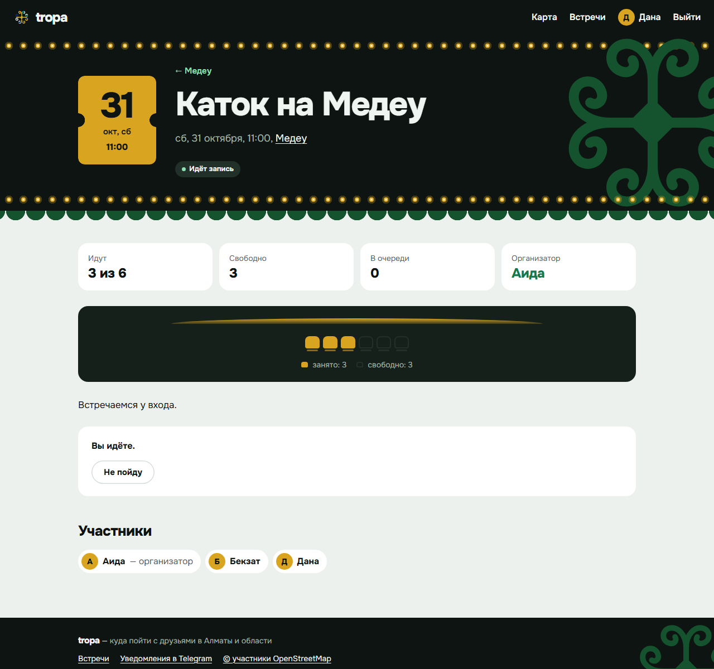
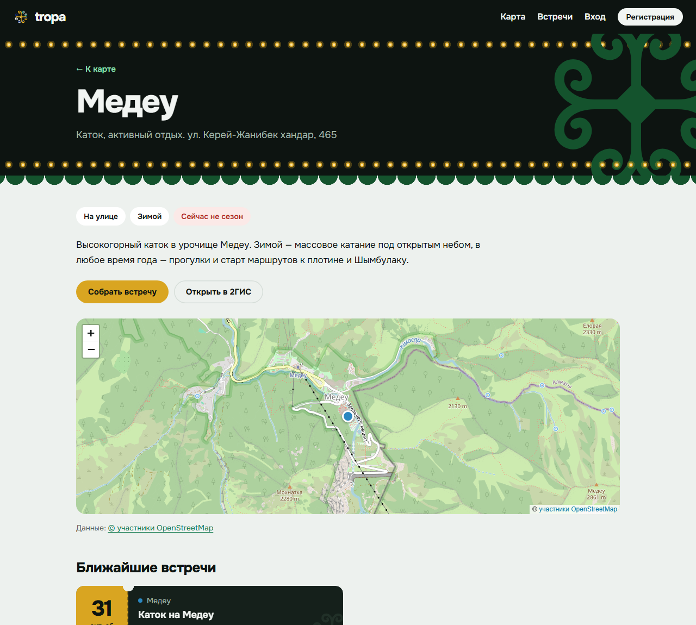
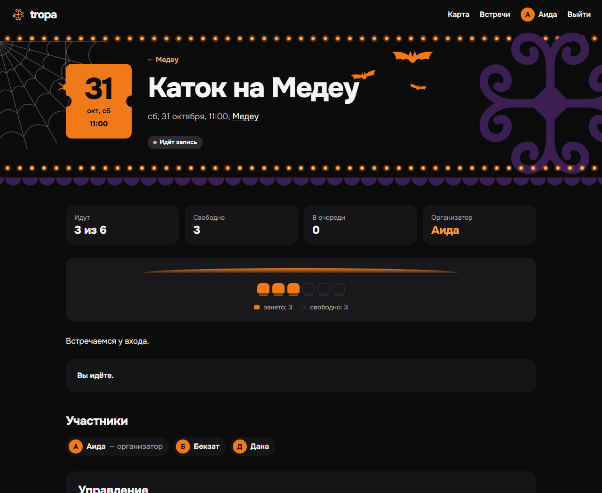
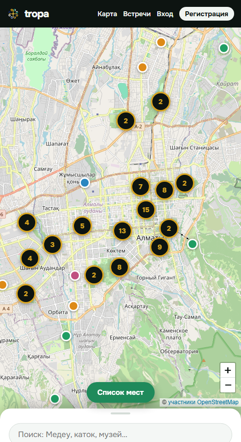
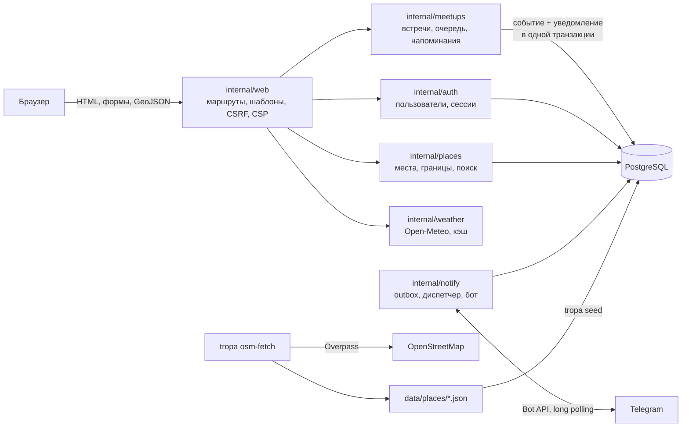

# Tropa

[](https://github.com/DarkIL1ght/Invication/actions/workflows/ci.yml)

Карта мест Алматы и Алматинской области, куда можно сходить с друзьями: тропы, пики, озёра, парки, катки и горнолыжки, кино, квесты, музеи и театры. Когда на улице холодно, Tropa подсказывает места в тепле. Через карту собираются встречи — открытые для всех или только для друзей по ссылке. Если мест нет, можно встать в очередь: освободившееся место бот предложит в Telegram.

Пет-проект для портфолио: Go-бэкенд на стандартной библиотеке, PostgreSQL, без фронтенд-сборки.



| Встречи | Встреча: билет и схема зала |
|---|---|
|  |  |
| **Место** | **Стиль «Хэллоуин», тёмная тема** |
|  |  |

<p align="center"></p>

## Что внутри

- **Встречи и лист ожидания.** Запись идёт в транзакции с `SELECT … FOR UPDATE` по строке встречи, поэтому 50 одновременных записей на встречу с 10 местами дают ровно 10 идущих (вместе с организатором) и 41 человека в очереди. Это проверяет конкурентный тест на настоящей базе (`internal/meetups`). Позиции очереди всегда идут подряд, без дыр. Освободившееся место предлагается первому в очереди на 24 часа. Фоновый воркер снимает истёкшие предложения и передаёт место дальше.
- **Уведомления в Telegram через outbox.** Уведомление пишется в таблицу `notifications` в той же транзакции, что и само событие, поэтому не теряется, если Telegram недоступен. Диспетчер забирает пачку под `FOR UPDATE SKIP LOCKED` и отправляет её вне транзакции. На 429 ждёт `retry_after`, на 5xx делает экспоненциальный повтор, на 403 отвязывает чат. Telegram подключён без SDK, напрямую через `net/http`. Аккаунт привязывается по одноразовому коду, в базе хранится только SHA-256 кода.
- **Места из OpenStreetMap.** Команда `tropa osm-fetch` запрашивает Overpass с повторами и запасными серверами, сама раскладывает объекты по группам и находит дубли. Каждое место проверяется по настоящим полигонам области и города, а не по прямоугольнику. Данные лежат в `data/places/*.json` в git, поэтому каждая правка видна в диффе.
- **Безопасность.** Сессии хранятся в БД, в базе только SHA-256 токена. CSRF защищён double-submit, CSP — `default-src 'self'` без CDN: Leaflet и шрифты лежат в самом бинарнике. Пароли — bcrypt, смена пароля закрывает остальные сессии. Вход, регистрация и сброс пароля ограничены по частоте (по IP и по аккаунту), сброс — одноразовой ссылкой через Telegram-бота без раскрытия, есть ли такой аккаунт. Ссылка на встречу «для друзей» — 128 случайных бит, `Referrer-Policy: same-origin`.
- **Погода.** Open-Meteo с кэшем на 30 минут. В непогоду на карте появляется плашка «Места в тепле», у летних мест зимой — пометка «не сезон».
- **Оформление.** «Кинотеатр» в казахской гамме: встреча — сеанс, запись — билет, места — кресла зала; орнамент «қошқар мүйіз». В настройках можно выбрать стиль (базовый или «Хэллоуин») и тему (светлая, тёмная или как в системе). Выбор хранится в профиле.

## Архитектура



Один бинарник: шаблоны, статика, шрифты и SQL-миграции встроены через `go:embed`. Миграции применяются при старте. Каждая в своей транзакции под advisory lock, поэтому два экземпляра не применят их дважды. Подробная карта кода — в [CLAUDE.md](CLAUDE.md), план и история этапов — в [docs/ROADMAP.md](docs/ROADMAP.md).

Стек: Go 1.25 (`net/http` с паттернами методов, `html/template`, `log/slog`), PostgreSQL через `pgx/v5`, Leaflet + markercluster. Внешние Go-зависимости — только `pgx` и `x/crypto`.

## Запуск

С Docker:

```sh
docker compose up --build
# http://127.0.0.1:8080
```

С локальным PostgreSQL:

```sh
psql -U postgres -c "CREATE ROLE tropa LOGIN PASSWORD 'tropa'" -c "CREATE DATABASE tropa OWNER tropa"
cp .env.example .env        # адрес базы и порт; .env не попадает в git
go run ./cmd/tropa serve    # http://127.0.0.1:8080
```

Загрузить места на карту (повторный запуск ничего не меняет) и выдать себе роль админа:

```sh
go run ./cmd/tropa seed
go run ./cmd/tropa osm-fetch                   # новые кандидаты из OSM в data/places/candidates.json
go run ./cmd/tropa make-admin you@example.kz   # после регистрации на сайте
```

Уведомления в Telegram включаются токеном бота: см. [docs/telegram.md](docs/telegram.md). Без токена сайт работает так же, только без уведомлений.

В GoLand есть готовая конфигурация запуска **Tropa serve** (`.run/Tropa.run.xml`). Приложение само находит `.env` в корне проекта. Переменные окружения важнее файла.

## Тесты

```sh
go test ./...                     # без базы тесты, которым нужна БД, пропускаются
TROPA_TEST_DATABASE_URL=$DATABASE_URL go test ./...
```

Каждый тест с базой работает в своей временной схеме, поэтому тесты не мешают друг другу и не трогают рабочие данные. В CI (GitHub Actions) на каждый пуш запускаются `gofmt`, `go vet`, все тесты с PostgreSQL 18 и сборка Docker-образа.

## Данные

Данные о местах с `source: osm` взяты из [OpenStreetMap](https://www.openstreetmap.org/copyright): © участники OpenStreetMap, лицензия ODbL. Остальные места внесены вручную. Данные 2ГИС не используются, потому что их лицензия запрещает хранить данные из API. У каждого места есть обычная ссылка «Открыть в 2ГИС». Подробнее про отбор мест — в [data/places/README.md](data/places/README.md).

Шрифт Onest — SIL Open Font License (`internal/web/static/fonts`). Leaflet и Leaflet.markercluster лежат в `internal/web/static/vendor` вместе со своими лицензиями.

## Статус

- [x] Аккаунты: регистрация, вход, сессии в БД, CSRF
- [x] Места: модель, проверка, seed-файлы, поиск по рамке и фильтрам
- [x] Карта (Leaflet + OSM): кластеры, фильтры в ссылке, поиск, шторка на телефоне, «Открыть в 2ГИС»
- [x] Импорт из OSM и первая волна мест, проверка по настоящим границам
- [x] Погода: «места в тепле» в непогоду, пометка «не сезон»
- [x] Встречи: открытые и для друзей, запись и лист ожидания под блокировкой строки, предложение места на 24 часа
- [x] Уведомления в Telegram: outbox с повторами, освободилось место, перенос, отмена, напоминания
- [x] Профиль: имя, пароль, публичная страница
- [x] Дизайн «кинотеатр», стили «базовый» и «Хэллоуин», светлая и тёмная темы
- [x] CI: gofmt, vet, тесты с PostgreSQL, сборка образа
- [x] Деплой: VPS, Docker Compose, Caddy с HTTPS, бэкапы
- [x] Защита входа (лимиты), сброс пароля через бота, админка
- [ ] Предложить место + модерация
- [x] Чат встречи: SSE, история, уведомления в Telegram
- [x] Друзья: взаимно через заявку, встречи «для друзей» видны друзьям
