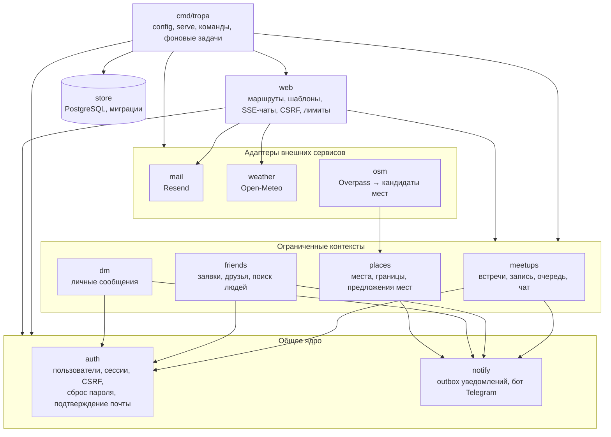

# Архитектура Tropa

Карта мест Алматы и области и встречи на ней. Документ описывает, как устроен код и почему. Обновляется вместе с кодом.

## Принципы

- **Пакет = ограниченный контекст (DDD).** У каждого контекста своя модель, правила и хранилище: встречи, места,
  друзья, личные сообщения, учётные записи, уведомления. Наружу — сервис с понятными методами (`meetups.Service.Join`).
- **Модель отдельно от SQL внутри контекста:** типы и правила (`meetup.go`, `user.go`, `message.go`, `places.go`) не
  обращаются к базе; запросы и транзакции — в `service.go` / `store.go` того же пакета.
- **SQL рядом с правилами — осознанно.** Запись на встречу, очередь, outbox уведомлений держатся на транзакциях с
  блокировкой строк (`FOR UPDATE`, `pg_advisory_xact_lock`). Разносить их по «репозиторию» и «сервису» через интерфейсы —
  значит протаскивать транзакцию через слои ради абстракции с одной реализацией. Корректность проверяют конкурентные
  тесты на настоящей PostgreSQL.
- **HTTP — отдельный слой** (`internal/web`): маршруты, формы, шаблоны, SSE, лимиты попыток. SQL в нём нет.
- **Окружение читается только в `cmd/tropa`** (`config.go`); пакеты получают готовые значения.
- **Зависимости минимальны:** только `pgx` и `x/crypto`; Telegram, Resend, Open-Meteo, Overpass — на `net/http`.

## Контексты и зависимости

| Пакет | Ответственность |
|---|---|
| `meetups` | Встреча: видимость, статусы и разрешённые переходы, вместимость, запись и очередь с предложением места на 24 ч, напоминания, чат участников |
| `places` | Место: группы и виды, точные границы области и города, нормализация и проверка, поиск по карте, предложения мест и модерация, seed из `data/places` |
| `friends` | Дружба как одна строка на пару, встречная заявка = принятие, поиск людей |
| `dm` | Личные сообщения только между друзьями, непрочитанные |
| `auth` | Пользователь, bcrypt, сессии (в базе только SHA-256 токена), CSRF double-submit, сброс пароля, коды подтверждения почты, роли |
| `notify` | Уведомления: запись в outbox в транзакции события, рассылка с арендой строк и повторами, привязка Telegram |
| `mail`, `weather`, `osm` | Адаптеры внешних сервисов; без них сайт работает |
| `store` | Пул PostgreSQL и миграции (`migrations/NNN_*.sql`, под advisory lock) |
| `web` | HTTP-слой: страницы на `html/template`, JSON для карты, SSE-чаты, лимиты, flash-сообщения |
| `cmd/tropa` | Настройки, сборка зависимостей, команды `serve`, `migrate`, `seed`, `make-admin`, `reset-link`, `osm-fetch`, фоновые задачи |

## Поток запроса (участник уходит со встречи)

1. `web` проверяет сессию и CSRF (`auth.Middleware`), подтверждение почты (`s.verified`).
2. `meetups.Service.Leave` открывает транзакцию, блокирует строку встречи (`lockMeetup`, `FOR UPDATE`) и удаляет участника;
   позиции очереди сдвигаются без дыр (`closeGap`).
3. Освободилось место — `fillSeats` предлагает его первому в очереди (`offered` на 24 ч) и пишет уведомление в outbox
   `notifications` **в той же транзакции** (`notify.Enqueue`): нет события без уведомления и наоборот.
4. Коммит; воркер `notify.RunDispatch` позже отправляет сообщение в Telegram вне транзакции. Не ответил за 24 ч —
   `ExpireOffers` (фоновая задача раз в минуту) снимает предложение и предлагает место следующему.

## Ключевые решения

- **Outbox уведомлений** вместо отправки в обработчике: событие и уведомление атомарны, бот может быть недоступен.
  Поэтому некоторые функции принимают колбэк с `pgx.Tx` (например, `auth.RequestReset`): письмо или сообщение ставится
  в очередь в транзакции, которая создаёт токен.
- **Встречи «для друзей»** видны только по ссылке с 16 случайными байтами; неверный токен неотличим от отсутствующей встречи.
- **Чаты — SSE через общий `hub` в памяти** + догрузка из базы по `Last-Event-ID`: одна копия приложения, без брокера.
- **Данные мест — только OpenStreetMap и ручная проверка**; 2ГИС — только ссылкой (лицензия запрещает хранение).
- **Лимиты входа и сброса пароля — на пару «IP + email» и общие на IP**, без общего лимита на аккаунт: перебор паролей с многих
  IP сдерживается только стоимостью bcrypt и длиной пароля, а запросы сброса с многих IP не ограничены на один аккаунт, зато по
  одному email нельзя заблокировать чужой вход или сброс.
- **Миграции только добавляются**, старые файлы не меняются.

## Тесты

Тесты лежат рядом с кодом. Логика с транзакциями проверяется на настоящей PostgreSQL (`storetest.New` — отдельная схема
на тест, переменная `TROPA_TEST_DATABASE_URL`), в том числе конкурентными тестами записи на встречу. Без базы такие
тесты пропускаются, в CI база поднимается сервисом.

## История

2026-11-03: в рамках общих правил архитектуры проектов модель отделена от SQL в `meetups`, `auth`, `dm`; настройки
окружения собраны в `cmd/tropa/config.go`, `cmd/tropa` разложен по файлам. Полный разрез на domain/repository/service
сознательно не делался (см. «Принципы»).
